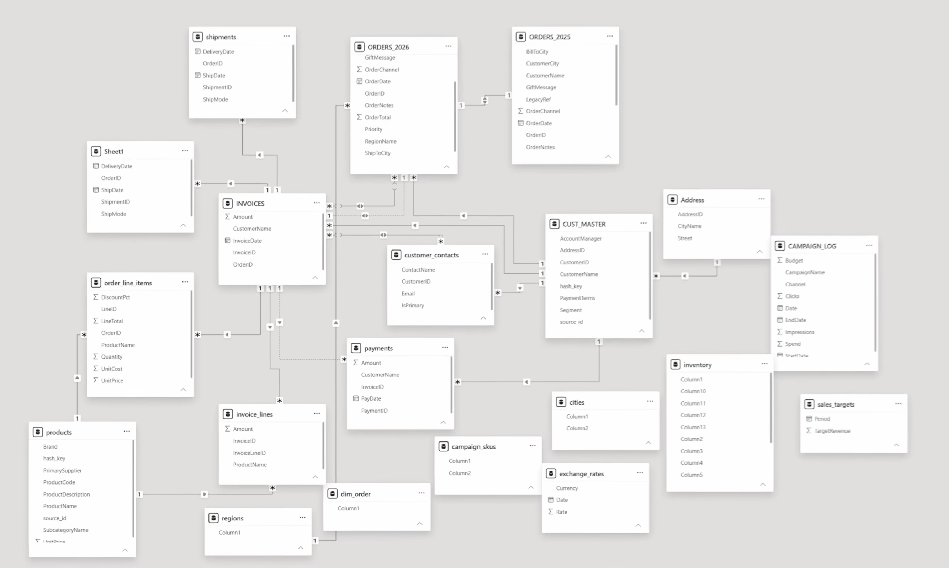
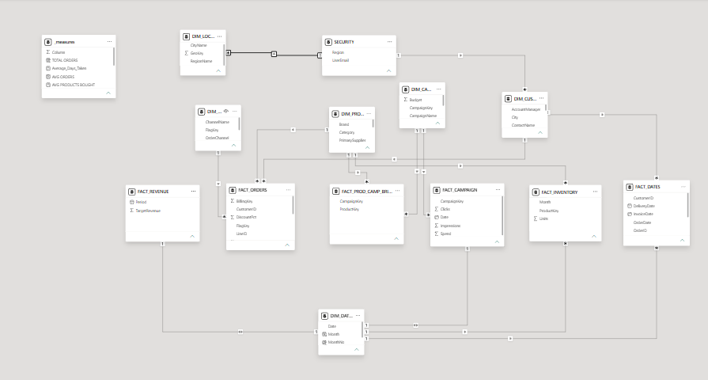
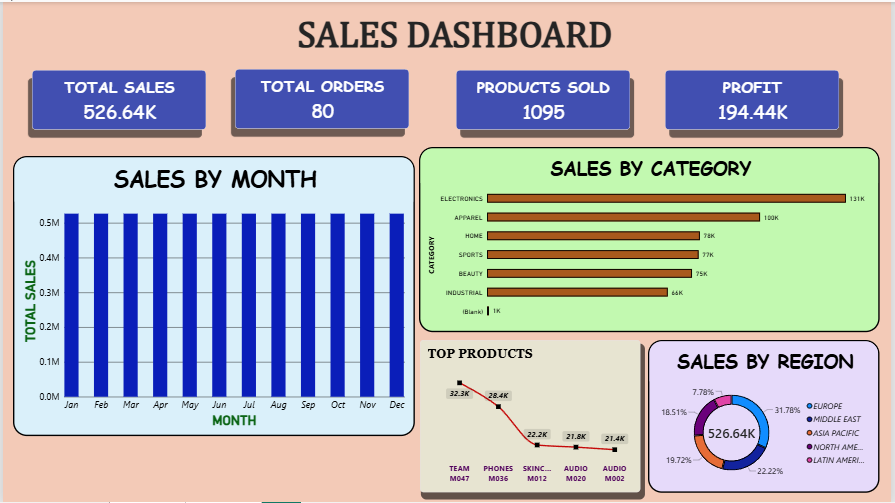
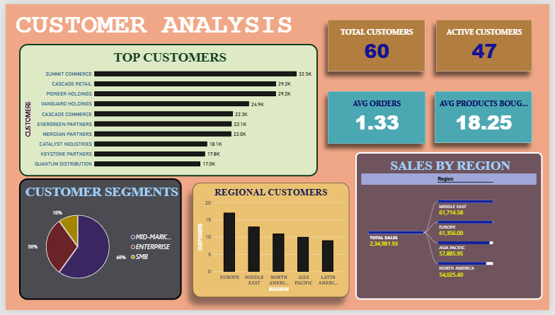

# Sales & Customer Intelligence: End-to-End Power BI Data Modeling & Analytics

An end-to-end Power BI business intelligence project focusing on **enterprise data model refactoring**, ETL data processing, and building an executive **two-page interactive dashboard** (Sales Dashboard & Customer Analysis).

---

## 📌 Table of Contents
- [Project Overview](#-project-overview)
- [Data Model Transformation (Before vs. After)](#-data-model-transformation-before-vs-after)
  - [The Challenge: The Legacy / Clumsy Data Model](#the-challenge-the-legacy--clumsy-data-model)
  - [The Solution: The Refactored Star Schema Model](#the-solution-the-refactored-star-schema-model)
- [Two-Page Report & Dashboards](#-two-page-report--dashboards)
  - [Page 1: Sales Dashboard](#page-1-sales-dashboard)
  - [Page 2: Customer Analysis](#page-2-customer-analysis)
- [Key DAX Measures & Modeling Logic](#-key-dax-measures--modeling-logic)
- [Repository Structure](#-repository-structure)
- [How to Open & View the Report](#-how-to-open--view-the-report)

---

## 📌 Project Overview
This project simulates a real-world enterprise analytics challenge: taking a fragmented, legacy, and unprocessed data environment, rebuilding the data architecture into a robust, high-performance **Star / Snowflake Schema**, and delivering clear analytical reporting across Sales and Customer behaviour.

* **Primary Focus**: Data modeling, relationship repair, ETL normalization, and Star Schema design.
* **Secondary Focus**: Executive visualization, KPI tracking, and drill-down analytics (including Decomposition Tree exploration).

---

## 🔄 Data Model Transformation (Before vs. After)

The core achievement of this project was transforming a dysfunctional, cluttered data model into an optimized, scalable dimensional model.

### ❌ The Challenge: The Legacy / Clumsy Data Model
The raw model suffered from architectural bottlenecks, ambiguous relationships, and unprocessed source data:



#### Major Deficiencies in the Initial Model:
1. **Disconnected & Unprocessed Tables**:
   - Multiple disconnected tables existed without relationships (`Sheet1`, `inventory`, `campaign_skus`, `cities`, `regions`, `sales_targets`, `dim_order`, `exchange_rates`).
   - Unpromoted column headers (`Column1`, `Column2`, ..., `Column13`) and uncleaned field names.
2. **Fragmented Transactions Across Years**:
   - Order data was split across separate yearly tables (`ORDERS_2025` and `ORDERS_2026`) instead of being unioned/appended into a single consolidated Fact table.
3. **Ambiguous Relationships & Filter Issues**:
   - Multiple **Many-to-Many (`* : *`) relationships** and bi-directional cross-filtering between `INVOICES`, `customer_contacts`, and order tables, creating ambiguous filter propagation and unpredictable aggregation results.
4. **Redundant & Cluttered Schemas**:
   - Customer and invoice data was scattered across redundant tables (`CUST_MASTER`, `customer_contacts`, `Address`, `INVOICES`, `invoice_lines`, `payments`).

---

### ✅ The Solution: The Refactored Star Schema Model
The data model was redesigned from scratch into an intuitive, scalable, high-performance **Star / Snowflake Schema**:



#### Architectural Fixes & Improvements:
* **Separation of Concerns (Fact vs. Dimension)**:
  - **Fact Tables**: `FACT_ORDERS`, `FACT_REVENUE`, `FACT_CAMPAIGN`, `FACT_INVENTORY`, `FACT_DATES`.
  - **Dimension Tables**: `DIM_CUSTOMER`, `DIM_PRODUCTS`, `DIM_DATE`, `DIM_LOCATION`, `DIM_CAMPAIGN`, `DIM_CHANNEL`.
* **Clean 1-to-Many ($1:*$) Cardinality**:
  - Replaced ambiguous relationships with standard One-to-Many ($1:*$) relationships with **single-direction cross-filtering**, ensuring optimal performance and accurate DAX evaluation.
* **Bridge Table Implementation**:
  - Implemented `FACT_PROD_CAMP_BRIDGE` to resolve complex relationships between Products and Marketing Campaigns cleanly without circular loops.
* **Dedicated Measures Repository**:
  - Consolidated all DAX measures into a dedicated `_measures` table for clean organization and project maintainability.
* **Row-Level Security (RLS) Preparation**:
  - Structured a `SECURITY` table mapped by `Region` and `UserEmail` for enterprise-ready data governance.

---

## 📊 Two-Page Report & Dashboards

### Page 1: Sales Dashboard
The Sales Dashboard provides an executive summary of revenue, volume, and profitability drivers across time, product lines, and global territories.



* **Executive KPIs**:
  * **Total Sales**: $526.64K
  * **Total Orders**: 80
  * **Products Sold**: 1,095 units
  * **Profit**: $194.44K
* **Visual Breakdown**:
  * **Sales by Month**: Steady monthly pacing across the calendar year.
  * **Sales by Category**: Category rankings led by **Electronics ($131K)** and **Apparel ($100K)**, followed by Home ($78K), Sports ($77K), Beauty ($75K), and Industrial ($66K).
  * **Top Products**: Line analysis highlighting top-performing SKUs (`TEAM M047` at $32.3K, `PHONES M036` at $28.4K).
  * **Sales by Region**: Geographic distribution dominated by **Europe (31.78%)** and the **Middle East (22.22%)**, with Asia Pacific (19.72%) and North America (18.51%).

---

### Page 2: Customer Analysis
The Customer Analysis page drills down into client acquisition, activity rates, purchasing volume, and territory segmentation.



* **Customer Metrics**:
  * **Total Customers**: 60 accounts
  * **Active Customers**: 47 accounts (~78% activity rate)
  * **Average Orders per Customer**: 1.33
  * **Average Products Bought**: 18.25 units
* **Visual Breakdown**:
  * **Top Customers**: Account leaderboard headed by **Summit Commerce ($32.5K)**, **Cascade Retail ($29.2K)**, and **Pioneer Holdings ($29.2K)**.
  * **Customer Segments**: Portfolio split consisting of **Small & Medium Business (SMB: 60%)**, **Enterprise (30%)**, and **Mid-Market (10%)**.
  * **Regional Customers**: Customer concentration by region (Europe: 17, Middle East: 13, North America: 11, Asia Pacific: 10, Latin America: 9).
  * **Regional Sales Decomposition Tree**: Root-cause exploratory visual breaking down total sales across key operating regions.

---

## ⚡ Key DAX Measures & Modeling Logic

Measures were organized within a dedicated `_measures` table for clean separation from raw columns:

* **Total Orders**:
  ```dax
  TOTAL ORDERS = DISTINCTCOUNT(FACT_ORDERS[BillingKey])
  ```
* **Average Orders per Customer**:
  ```dax
  AVG ORDERS = DIVIDE([TOTAL ORDERS], DISTINCTCOUNT(FACT_ORDERS[CustomerID]), 0)
  ```
* **Average Products Bought**:
  ```dax
  AVG PRODUCTS BOUGHT = DIVIDE(SUM(FACT_ORDERS[Quantity]), DISTINCTCOUNT(FACT_ORDERS[CustomerID]), 0)
  ```
* **Average Days Taken**:
  Calculates the duration between order placement and fulfillment across delivery milestones.

---

## 📁 Repository Structure

```text
PROJECT/
│
├── DATASET/
│   └── dataset.xlsx               # Source uncleaned dataset used for the project
│
├── DOCS/
│   └── REPORT_VIEW.pdf             # Exported 2-page PDF presentation of the dashboards
│
├── IMAGES/
│   ├── DATA_MODEL_BEFORE.png       # Original unstructured / legacy data model
│   ├── DATA_MODEL_AFTER.png        # Refactored Star Schema data model
│   ├── DASHBOARD_1.png             # Screenshot of Sales Dashboard (Page 1)
│   └── DASHBOARD_2.png             # Screenshot of Customer Analysis (Page 2)
│
├── .gitignore                      # Git ignore rules for temporary & lock files
├── POWER_PROJECT.pbix              # Full Power BI Desktop report and data model
└── README.md                       # Comprehensive project documentation
```

---

## 🚀 How to Open & View the Report

1. **Instant PDF Preview**:
   Open the exported [REPORT_VIEW.pdf](DOCS/REPORT_VIEW.pdf) inside the `DOCS/` folder to view the full report without installing Power BI Desktop.
2. **Interactive Desktop Exploration**:
   - Clone or download this repository.
   - Open [POWER_PROJECT.pbix](POWER_PROJECT.pbix) in **Power BI Desktop**.
   - Navigate to the **Model View** to inspect the table relationships, and explore the **Report View** to interact with cross-filters, slicers, and visual tooltips.
